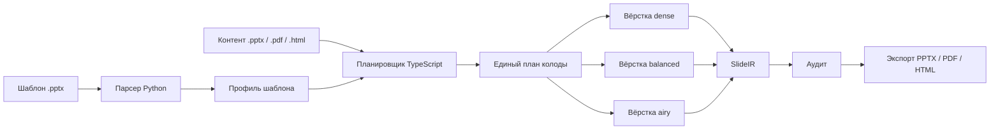
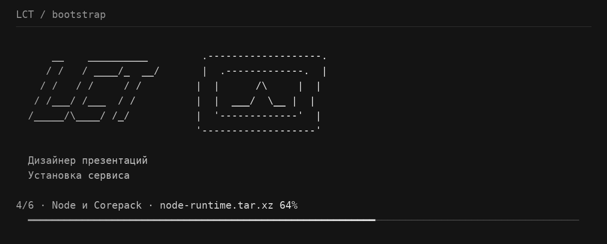
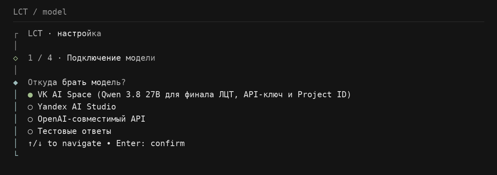
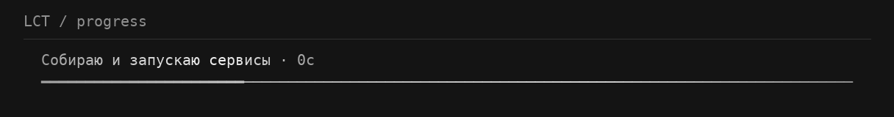
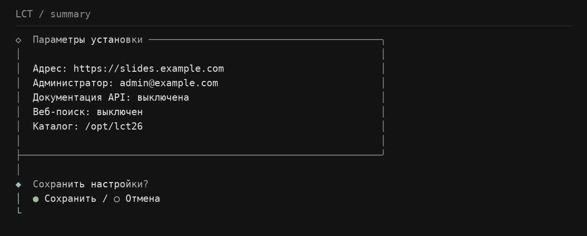

<div align="center">

# Цифровой дизайнер презентаций

**Генерируйте редактируемые презентации в стиле любого загруженного `.pptx`-шаблона.**

Разберите фирменный стиль один раз, дайте сервису контент и получите три самостоятельные
композиции с аудитом, превью и экспортом в PowerPoint, PDF и HTML.

[](https://github.com/TheAweny/case-14-ai-presentation-designer-team-41/actions/workflows/ci.yml)
[](https://github.com/TheAweny/case-14-ai-presentation-designer-team-41/actions/workflows/cd.yml)
[](LICENSE)
[](https://nodejs.org/)
[](https://www.python.org/)
[](https://docs.lct.aweny.link/)

[Демо-приложение](https://lct.aweny.link) · [Документация](https://docs.lct.aweny.link/) · [API reference](https://docs.lct.aweny.link/docs/api/) · [Кейс 14](docs/CASE.md) · [Требования](spec/requirements.md)

</div>

---

## Содержание

- [Что это](#что-это)
- [Почему это не очередной генератор слайдов](#почему-это-не-очередной-генератор-слайдов)
- [Как это работает](#как-это-работает)
- [Возможности](#возможности)
- [Быстрый старт](#быстрый-старт)
- [Установка одной командой](#установка-одной-командой)
- [Локальная разработка](#локальная-разработка)
- [Генерация через CLI](#генерация-через-cli)
- [Модели](#модели)
- [Интерфейс и скриншоты](#интерфейс-и-скриншоты)
- [Результат прогона](#результат-прогона)
- [Архитектура](#архитектура)
- [Проверки](#проверки)
- [Структура репозитория](#структура-репозитория)
- [Документация](#документация)
- [Участие в проекте](#участие-в-проекте)
- [Лицензия](#лицензия)

## Что это

Цифровой дизайнер презентаций — open-source сервис для сборки презентаций по референсному
шаблону. На вход он принимает:

- `.pptx`-шаблон с нужной айдентикой;
- контент из `.pptx`, `.pdf`, `.html`, Markdown или текста;
- настройки прогона: число слайдов, seed и от одной до трёх layout-стратегий.

На выходе — три отличающиеся редактируемые колоды, созданные на основе реальных композиций
шаблона, а не изображения поверх слайда:

- `.pptx` с сохранёнными мастер-макетами, темой, шрифтами и нативными текстовыми блоками;
- `.pdf` для быстрой отправки и просмотра;
- `.html` и PNG-превью для интерфейса;
- детерминированный и контекстный аудит;
- manifest с версиями агентов, промптов, моделей, seed, хешами и таймингами.

> **Статус:** основной путь генерации в `main` рабочий и проверен на реальных прогонах. Замеры
> производительности — технические evidence, а не SLA и не оценка качества на каждом неизвестном
> шаблоне. Подробности и границы утверждений — в [docs/EVIDENCE.md](docs/EVIDENCE.md) и
> [docs/GENERATION.md](docs/GENERATION.md).

## Почему это не очередной генератор слайдов

| Обычный генератор                    | Цифровой дизайнер                                                   |
| ------------------------------------ | ------------------------------------------------------------------- |
| Придумывает собственную тему         | Извлекает правила из загруженного `.pptx`                           |
| Рисует приблизительный фон и палитру | Сохраняет реальные мастер-макеты и композиции шаблона               |
| Возвращает картинку                  | Возвращает редактируемый PowerPoint                                 |
| Делает один результат                | Параллельно строит `dense`, `balanced` и `airy`                     |
| Проверяет только наличие файла       | Проверяет геометрию, контраст, шрифты, заглушки и смысловые находки |
| Теряет прогресс при сбое             | Пишет события, checkpoints, manifest и позволяет продолжить прогон  |

## Как это работает



Граница слоёв намеренно проходит по вопросу «есть ли здесь модель»:

- **TypeScript** — интерфейс, API, Mastra-workflow, обращения к моделям и контекстный аудит.
- **Python** — разбор `.pptx`, детерминированная вёрстка, графики, таблицы, экспорт, рендер и
  проверки, которым нужен сам файл или его изображение.
- **Контракты** — Zod-схемы в `packages/contracts`; Pydantic-модели Python генерируются из них.

Подробная схема зависимостей и инварианты — в [docs/ARCHITECTURE.md](docs/ARCHITECTURE.md).

## Возможности

- анализ палитры, типографики, сетки, master/layout и повторяющихся паттернов шаблона;
- единый grounded-план, переиспользуемый всеми вариантами;
- три визуально и текстово различающиеся стратегии: `dense`, `balanced`, `airy`;
- native editable shapes, таблицы и графики вместо «скриншотов слайдов»;
- входные адаптеры для PPTX, PDF, HTML и текстовых материалов;
- визуальные и смысловые проверки до выдачи результата;
- редактор с live-аудитом и журналом `PatchOp`;
- CLI `lct` для установки, диагностики, пользователей, backup, update и генерации;
- локальный Docker Compose стек с PostgreSQL и отдельным Python engine;
- fake/record providers для тестов без GPU и сети;
- OpenAPI, generated contracts и воспроизводимые manifests.

## Быстрый старт

### Вариант A: готовое приложение

Откройте [lct.aweny.link](https://lct.aweny.link), загрузите шаблон и контент, выберите вариант
и экспортируйте готовую колоду.

### Вариант B: установка на Ubuntu

```bash
curl -fsSL https://raw.githubusercontent.com/TheAweny/case-14-ai-presentation-designer-team-41/main/install.sh | bash
```

Установщик проверит окружение, подготовит Docker Compose, создаст секреты, спросит провайдера
модели и запустит мастер. После установки:

```bash
lct doctor
lct start
lct status
```

Пошаговая инструкция: [docs.lct.aweny.link/docs/cli/installation](https://docs.lct.aweny.link/docs/cli/installation/).

## Установка одной командой

Для автоматического bootstrap без интерактивных вопросов:

```bash
./install.sh --yes \
  --provider vk \
  --api-key "$MODEL_API_KEY" \
  --project-id "$VK_PROJECT_ID" \
  --admin-email admin@example.com \
  --admin-password 'change-me'
```

Также поддерживаются `ai-studio` и OpenAI-compatible endpoints. Список команд:

| Команда                               | Назначение                                   |
| ------------------------------------- | -------------------------------------------- |
| `lct start`, `lct stop`, `lct status` | управление Docker Compose                    |
| `lct logs [service]`                  | логи сервиса                                 |
| `lct configure`, `lct model`          | настройки окружения и модели                 |
| `lct user`, `lct user admin`          | управление пользователями                    |
| `lct backup`, `lct update`            | резервная копия и обновление                 |
| `lct doctor`                          | проверка модели, аккаунтов, engine и сервиса |
| `lct generate <config.yaml>`          | генерация по конфигурации                    |

## Локальная разработка

### Требования

- Node.js 22.13+;
- Yarn 4 через Corepack — **не npm и не pnpm**;
- Python 3.12+ и `uv` — **не pip/poetry**;
- Docker и Docker Compose для полного стека;
- LibreOffice, Poppler и fontconfig для локальной генерации без Docker.

### Установка и запуск

```bash
corepack enable
yarn install
uv sync
cp .env.example .env

# База данных
docker compose up -d postgres

# API, web и engine — в отдельных терминалах
yarn nx run api:serve
yarn nx run web:serve
uv run uvicorn engine.api:app --reload --port 8000
```

- Web: [http://localhost:3000](http://localhost:3000)
- API: [http://localhost:3001](http://localhost:3001)
- Engine: [http://localhost:8000](http://localhost:8000)
- Swagger/OpenAPI: `/api/docs` и `/api/docs-json` при `API_DOCS_ENABLED=true`

### Полный стек в Docker

```bash
cp .env.example .env
docker compose up --build
```

Поднимаются `web`, `api`, `engine` и `postgres`. PostgreSQL слушает `5433`, а бинарные входы и
результаты хранятся в `runs/`, не в базе данных.

## Генерация через CLI

Конфигурация-пример уже содержит шаблон и материал из `examples/`:

```bash
lct generate configs/run.example.yaml
```

Или напрямую через скрипт:

```bash
node --env-file=.env --import tsx scripts/generate-presentation.mts \
  /absolute/path/template.pptx \
  /absolute/path/brief.md \
  10
```

Время генерации считается после отправки запроса: профиль шаблона подготавливается отдельно,
план строится один раз, затем варианты вёрстки идут параллельно. Для трёх вариантов действует
целевой бюджет до пяти минут.

## Модели

Сервис использует OpenAI-compatible Chat API. Настройки задаются в `.env`:

```dotenv
# Empty uses the configured live runtime; set fake for offline recordings.
MODEL_PROVIDER=
LLM_BASE_URL=https://your-provider.example/v1
LLM_MODEL=your-model
MODEL_API_KEY=your-key
# Необязательно: Project-ID=... или другие заголовки через запятую
MODEL_HEADERS=Project-ID=your-project-id
```

Для локальных тестов сеть и GPU не нужны:

```dotenv
MODEL_PROVIDER=fake
```

`fake` использует записанные ответы из `registry/recordings/`, а `record` сохраняет ответы
реального провайдера. Каталог и ограничения моделей: [docs/MODELS.md](docs/MODELS.md).

## Интерфейс и скриншоты

Ниже — реальные изображения CLI из документации проекта.

| Bootstrap                                               | Настройка модели                                      |
| ------------------------------------------------------- | ----------------------------------------------------- |
|  |  |

| Прогресс генерации                                               | Итог прогона                                                   |
| ---------------------------------------------------------------- | -------------------------------------------------------------- |
|  |  |

Больше экранов: [меню](apps/docs/public/images/cli/menu.png), [настройки](apps/docs/public/images/cli/settings.png), [пользователи](apps/docs/public/images/cli/users.png).

## Результат прогона

Каждый успешный run можно исследовать без базы данных по каталогу `runs/<run-id>/`:

```text
runs/<run-id>/
├── composition-plan.json    # общий план для вариантов
├── summary.json              # сводка состояния и артефактов
├── manifest.json             # версии, хеши и тайминги
└── variants/
    ├── dense/
    │   ├── deck.pptx
    │   ├── previews/deck.pdf
    │   ├── slides/            # PNG-превью
    │   ├── audit.json
    │   └── events.jsonl
    ├── balanced/
    └── airy/
```

Для незавершённого или неуспешного прогона сохраняется `failure.json` с диагностикой. Содержимое
`runs/` и `.env` не коммитится.

## Архитектура

```text
apps/web                 Next.js UI, библиотека, чат, редактор, экспорт
apps/api                 NestJS API, auth, runs, Mastra orchestration
apps/cli                 lct onboard/doctor/start/generate
packages/contracts       Zod source of truth + generated JSON Schema
packages/pipeline        Mastra workflows, agents, contextual audit
packages/slide-audit     deterministic SlideIR checks
packages/slide-renderer  SlideIR -> React preview and HTML
packages/engine-client   typed API client for Python engine
engine/parser            PPTX -> template profile
engine/layout            deterministic profile + plan -> SlideIR
engine/visuals           native charts, tables and diagrams
engine/export            SlideIR -> PPTX/PDF
engine/render            PPTX -> PNG via LibreOffice
engine/checks            file/render based audit
registry/agents          versioned prompts and agent configs
spec/                    requirements and integration evidence
```

Ключевой инвариант проекта: в Python engine нет вызовов модели, а в TypeScript нет работы с
`.pptx`. Слои engine не импортируют друг друга — их соединяет только API движка.

## Проверки

Минимальный полный набор перед pull request:

```bash
yarn lint
yarn typecheck
yarn test
yarn build

yarn lint:py
yarn typecheck:py
yarn test:py
yarn boundaries:py

yarn codegen
git diff --exit-code -- packages/contracts/schema engine/src/engine/contracts/_generated.py
uv run write-golden-ir --check
```

Генераторы документации:

```bash
yarn docs:audit
```

GitHub Actions повторяет эти проверки в [CI workflow](.github/workflows/ci.yml). Правила вкладов,
фикстуры контрактов и тестовый протокол — в [CONTRIBUTING.md](CONTRIBUTING.md).

## Структура репозитория

- `apps/` — пользовательское приложение, API, CLI и документационный портал;
- `packages/` — контракты, pipeline, аудит, renderer и engine client;
- `engine/` — Python-движок документов;
- `registry/` — промпты и версии агентов вне исходного кода;
- `examples/` — безопасные примеры шаблонов и контента;
- `spec/` — требования и проверяемые интеграционные соглашения;
- `docs/` — архитектура, генерация, evidence, compliance и решения;
- `infra/` — Dockerfiles, шрифты и deployment-конфигурация.

## Документация

- [Портал документации](https://docs.lct.aweny.link/) — руководство пользователя, CLI, операции,
  internals и API;
- [Архитектура](docs/ARCHITECTURE.md) — пайплайн и границы TypeScript/Python;
- [Реальная генерация](docs/GENERATION.md) — provider, checkpoints, экспорт и ограничения;
- [Восстановление прогонов](docs/GENERATION-RECOVERY.md) — durable state, lease/fencing и resume;
- [Evidence](docs/EVIDENCE.md) — измерения и проверенные артефакты;
- [Compliance](docs/COMPLIANCE.md) — трассировка требований кейса;
- [Модели](docs/MODELS.md) — поддерживаемые провайдеры и лицензии;
- [Аудит](docs/AUDIT.md) — сгенерированный реестр проверок;
- [OpenAPI](https://docs.lct.aweny.link/docs/api/) — интерактивный справочник маршрутов;
- [Участие](CONTRIBUTING.md) — правила разработки и ревью;
- [Лицензии зависимостей](docs/LICENSES.md).

## Участие в проекте

Небольшой патч начинается так:

```bash
git checkout -b dev/my-change
# внесите изменение
yarn lint && yarn typecheck && yarn test
```

Пожалуйста, сохраняйте границы слоёв, не зашивайте имена конкретного шаблона, не редактируйте
сгенерированные файлы вручную и добавляйте тесты к новым audit checks. Полный процесс — в
[CONTRIBUTING.md](CONTRIBUTING.md).

## Лицензия

Проект распространяется под [Apache License 2.0](LICENSE). Уведомления о сторонних компонентах —
в [NOTICE](NOTICE), полный отчёт — в [docs/LICENSES.md](docs/LICENSES.md).

<div align="center">

**Сделано для редактируемых презентаций, а не для картинок с текстом.**

[⬆ Наверх](#цифровой-дизайнер-презентаций)

</div>
